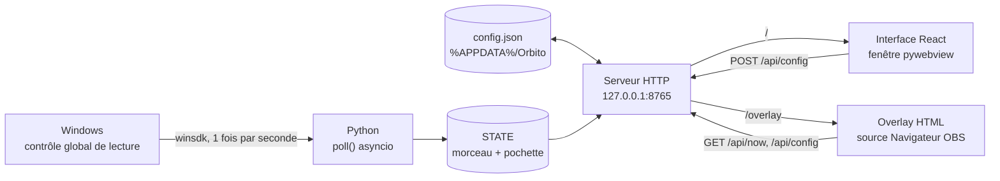

# Orbito

Overlay « morceau en cours » pour **OBS**, pensé comme un remplaçant de Tuna. Orbito lit ce que Windows sait déjà de ta musique : **aucune API Spotify, aucun compte, aucune clé, aucune connexion**. Tu règles l'apparence dans une fenêtre dédiée avec un aperçu en direct, puis tu colles une adresse dans OBS.

- Titre, artiste, album, pochette et barre de progression en temps réel
- Pochette ronde qui tourne en lecture, effet disque vinyle, dégradés, ombres, contours
- Liste de sélection de toutes les polices installées sur le PC, avec recherche et aperçu de chaque police
- Plus de soixante réglages, 8 thèmes prêts à l'emploi, export et import de la configuration
- Masquer / afficher l'overlay par raccourci clavier global ou par Stream Deck
- Icône dans la zone de notification, démarrage avec Windows, instance unique
- Interface façon Discord, écran de démarrage (splash) et mises à jour automatiques depuis les releases GitHub

> Windows 10 / 11 uniquement : la lecture du morceau repose sur une API propre à Windows.

## Technologies utilisées

| Couche | Technologie | Rôle |
|---|---|---|
| Lecture du morceau | **Python 3.12** + [`winsdk`](https://github.com/pywinrt/python-winsdk) | Accès à l'API Windows Runtime `GlobalSystemMediaTransportControlsSessionManager` (SMTC) : titre, artiste, album, état, position, durée, pochette |
| Serveur local | `http.server` (`ThreadingHTTPServer`), bibliothèque standard | Sert l'interface, l'overlay et une petite API JSON sur `127.0.0.1:8765` |
| Boucle de lecture | `asyncio` dans un thread dédié | Interroge Windows une fois par seconde |
| Interface de réglages | **React 18** + **Vite 5** | Panneau de configuration avec aperçu en direct |
| Overlay OBS | HTML / CSS / JavaScript natifs, sans dépendance | Page unique intégrée à `orbito.py`, affichée par la source Navigateur d'OBS |
| Fenêtre de l'application | [`pywebview`](https://pywebview.flowrl.com) (WebView2) | Affiche l'interface React dans une vraie fenêtre Windows |
| Zone de notification | [`pystray`](https://github.com/moses-palmer/pystray) + `Pillow` | Icône, menu clic droit, réduction dans la zone de notification |
| Liste des polices | `ctypes` + `EnumFontFamiliesExW` (GDI) | Énumère les polices réellement installées |
| Raccourci clavier global | `RegisterHotKey` (user32) via `ctypes`, dans un thread dédié | Fonctionne même quand Orbito est réduit ou qu'un jeu a le focus |
| Démarrage avec Windows | `winreg` (clé `HKCU\...\Run`) | Active ou désactive le lancement automatique |
| Instance unique | Mutex Windows nommé via `ctypes` | Relancer Orbito ré-affiche la fenêtre existante |
| Distribution | **PyInstaller** (`--onefile`) | Produit un unique `Orbito.exe` avec l'interface embarquée |

### Pourquoi pas l'API Spotify ?

Windows expose à toutes les applications multimédia un « contrôle global de lecture » (celui des touches média et du volet de volume). Spotify, mais aussi les navigateurs, VLC, foobar2000 ou Apple Music y publient le morceau en cours. Orbito se branche dessus : ça fonctionne hors ligne, sans authentification, sans quota et avec n'importe quel lecteur compatible. Si Spotify est présent il est prioritaire, sinon Orbito suit la session de lecture active de Windows.

### Architecture



Le flux est volontairement simple : l'interface écrit la configuration, l'overlay la relit chaque seconde et se met à jour tout seul. Aucun WebSocket, aucun état partagé complexe.

### Comment fonctionne l'overlay

- Chaque réglage est appliqué par JavaScript sur des styles et des variables CSS (`--fg`, `--accent`, `--spin`, `--dur`...).
- La progression est interpolée côté Python à partir de `last_updated_time`, ce qui donne une barre fluide entre deux relevés Windows.
- L'animation d'entrée et de sortie est une transition CSS sur `transform` et `opacity`. La rotation de la pochette est une animation `@keyframes` dont on bascule seulement le `animation-play-state` : en pause, la pochette garde son angle au lieu de revenir à zéro.
- Les titres trop longs défilent avec une animation dont l'amplitude est calculée d'après la largeur réelle du texte.
- L'échelle globale utilise la propriété CSS `zoom`, ce qui garde tout aligné quelle que soit la taille choisie.

## Installation

### Utiliser l'application

1. Double-clique sur `build.bat` une première fois. Le script installe Node.js et Python 3.12 si besoin (via `winget`), construit l'interface et génère l'exécutable.
2. Lance `dist\Orbito.exe`.

### Lancer depuis les sources

```bat
build.bat        # une fois, pour construire orbito-ui\dist
lancer.bat       # lance Orbito sans créer d'exécutable
```

Prérequis : Windows 10/11, Python 3.12, Node.js LTS.

### Développer l'interface avec rechargement à chaud

Garde Orbito lancé (il fournit l'API), puis :

```bat
cd orbito-ui
npm install
npm run dev
```

Vite proxifie `/api` et `/overlay` vers `127.0.0.1:8765`. Pour tester dans la vraie application, relance `npm run build`.

## Mises à jour automatiques (GitHub)

Au lancement, Orbito affiche un écran de démarrage comme Discord et interroge `releases/latest` de ton dépôt GitHub. Si une version plus récente existe, il télécharge `Orbito.exe`, vérifie le fichier (taille et SHA-256 fournis par GitHub), remplace l'ancien exécutable et se relance tout seul. Ensuite, il revérifie toutes les 6 heures : en cours d'utilisation il te prévient seulement (bannière dans l'application et notification Windows), **il ne redémarre jamais pendant un stream**. Le bouton vert en bas à gauche, le panneau *Mises à jour* et le menu de l'icône permettent de vérifier à la demande ; l'installation au démarrage se désactive dans ce panneau.

Mise en place, une seule fois : dans `orbito.py`, remplace `GITHUB_REPO = "TON-PSEUDO/Orbito"` par ton dépôt (`proprietaire/depot`, public).

Publier une version :

1. Augmente `VERSION` dans `orbito.py` (ex. `1.2.0`)
2. `git tag v1.2.0` puis `git push origin v1.2.0`
3. Le workflow `.github/workflows/release.yml` construit `Orbito.exe` et l'attache à la release (tu peux aussi créer la release à la main en joignant un fichier nommé exactement `Orbito.exe`)

L'installation automatique ne concerne que l'exécutable. Lancé depuis les sources, Orbito détecte la mise à jour mais ouvre seulement la page de la release.

## Ajouter l'overlay dans OBS

1. Ajoute une source **Navigateur**
2. Colle `http://127.0.0.1:8765/overlay` (ne coche pas « Fichier local »)
3. Largeur 900, hauteur 260
4. Garde Orbito lancé

La position (gauche, centre, droite, haut, milieu, bas) et l'échelle se règlent dans Orbito : inutile de redimensionner la source dans OBS.

Les polices sont celles installées sur le PC où tourne OBS. Si tu changes de machine, installe la police ou choisis-en une autre.

## Masquer l'overlay (raccourci clavier et Stream Deck)

Le panneau **Masquer l'overlay** de l'interface propose trois façons de masquer ou d'afficher l'overlay, avec la même animation de sortie que d'habitude :

- **Raccourci clavier global** : clique sur le champ, appuie sur ta combinaison (Ctrl, Alt, Maj ou Win avec une lettre, un chiffre, une touche F, etc.), elle est enregistrée aussitôt. Par défaut `Ctrl + Alt + H`. Si Windows indique qu'elle est déjà prise par un autre programme, un message s'affiche : choisis-en une autre.
- **Stream Deck** : ajoute l'action *Site web* (catégorie Système), colle l'une des adresses ci-dessous et coche l'option d'accès en arrière-plan (requête GET) pour ne pas ouvrir de navigateur.
- **Icône de notification** : clic droit puis *Masquer l'overlay*.

| Adresse | Effet |
|---|---|
| `http://127.0.0.1:8765/api/overlay/toggle` | Bascule masqué / affiché |
| `http://127.0.0.1:8765/api/overlay/hide` | Masque |
| `http://127.0.0.1:8765/api/overlay/show` | Affiche |

L'état masqué n'est pas enregistré : l'overlay est de nouveau visible au prochain lancement. L'aperçu de l'interface reste toujours visible. Ces adresses fonctionnent avec tout outil capable d'envoyer une requête HTTP (Touch Portal, AutoHotkey, un script...).

## Réglages disponibles

| Section | Réglages |
|---|---|
| Cadre | couleur et opacité du fond, dégradé (deuxième couleur, angle), contour (épaisseur, couleur, style), arrondi, largeur, marge intérieure, espace pochette / texte, ombre (couleur, flou, décalage) |
| Pochette | affichage, taille, forme ronde / arrondie / carrée, côté, effet vinyle, contour, ombre, rotation (durée d'un tour, sens inverse) |
| Texte | police (liste des polices installées), couleurs, tailles, graisses, majuscules, italique, espacement des lettres, interligne, ombre du texte, alignement, défilement (durée), afficher l'artiste / l'album |
| Temps et barre | temps écoulé / total / restant, barre sous le texte ou collée en bas, couleurs, opacité du fond de barre, épaisseur, arrondi, lueur |
| Affichage | animation d'entrée (gauche, droite, haut, bas, zoom, fondu) et sa durée, durée de visibilité, masquer en pause, échelle, opacité globale, position |

Thèmes fournis : Orbito, Classique, Verre, Néon, Minimal, Clair, Vinyle, Aurore. Appliquer un thème garde ta police, ta largeur, ton échelle et ta position. Les boutons **Exporter** et **Importer** sauvegardent ou restaurent toute la configuration au format JSON.

La configuration est enregistrée dans `%APPDATA%\Orbito\config.json`.

## API locale

| Méthode | Route | Description |
|---|---|---|
| GET | `/` | Interface de réglages |
| GET | `/overlay` | Page de l'overlay (`/overlay?preview` pour l'aperçu avec un morceau factice) |
| GET | `/api/now` | Morceau en cours : titre, artiste, album, état, progression, durée |
| GET | `/api/cover` | Pochette du morceau (PNG ou JPEG) |
| GET | `/api/config` | Configuration actuelle |
| GET | `/api/defaults` | Valeurs par défaut |
| GET | `/api/fonts` | Polices installées |
| POST | `/api/config` | Met à jour la configuration (fusion) |
| POST | `/api/reset` | Rétablit les valeurs par défaut |
| GET | `/splash`, `/api/boot` | Écran de démarrage et son état |
| GET | `/api/update` | État des mises à jour (version, dernière version, progression) |
| POST | `/api/update/check`, `/install`, `/open` | Vérifie, installe, ouvre la page de la release |
| GET / POST | `/api/overlay/toggle`, `/hide`, `/show` | Masque, affiche ou bascule l'overlay |
| POST | `/api/export`, `/api/import` | Exporte / importe la configuration via une boîte de dialogue Windows |
| POST | `/api/show` | Ré-affiche la fenêtre |

`/api/now` renvoie aussi `hidden` (overlay masqué) et `hotkeyOk` (raccourci bien enregistré).

Le serveur écoute uniquement sur `127.0.0.1` : rien n'est exposé sur le réseau.

## Structure du projet

```
Orbito/
├── orbito.py            serveur, lecture Windows, overlay, fenêtre et icône de notification
├── orbito-ui/           interface de réglages (React + Vite)
│   └── src/
│       ├── App.jsx      composants, sélecteur de police, thèmes, import / export
│       ├── fields.js    description de tous les réglages, thèmes, valeurs de secours
│       └── styles.css
├── .github/workflows/   publication automatique de Orbito.exe sur GitHub
├── build.bat            construit l'interface puis Orbito.exe
├── lancer.bat           lance depuis les sources
├── orbito.png / .ico    icônes
└── README.md
```

Pour ajouter un réglage : une valeur par défaut dans `DEFAULTS` (`orbito.py`), son application dans `loadConfig()` de l'overlay, puis une ligne dans `fields.js`.

## Limites connues

- Windows uniquement
- Le lecteur doit publier ses informations au contrôle global de lecture de Windows (c'est le cas de Spotify, des navigateurs, de VLC et de la plupart des lecteurs)
- La qualité de la pochette dépend de ce que le lecteur fournit à Windows
